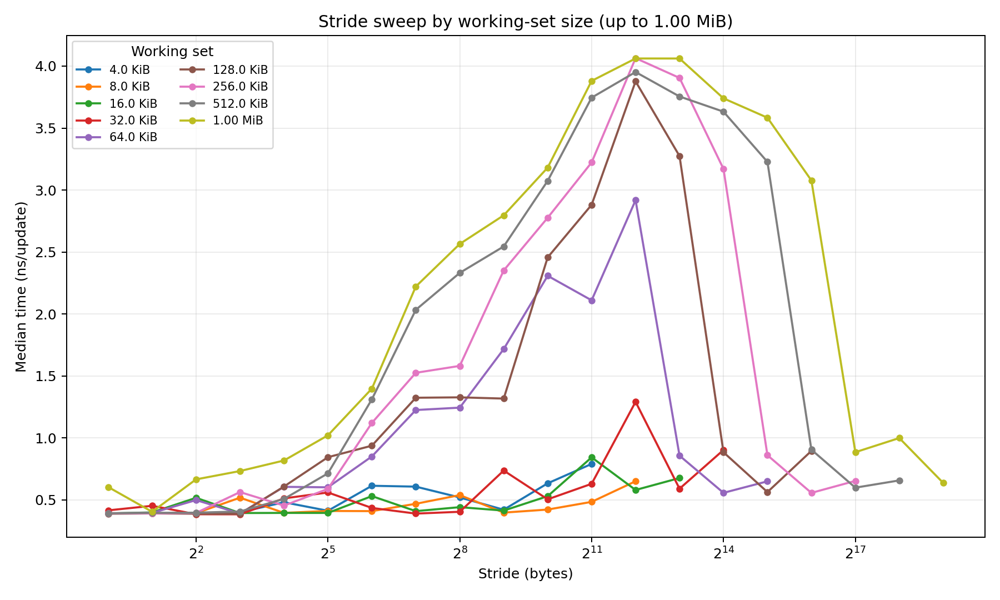
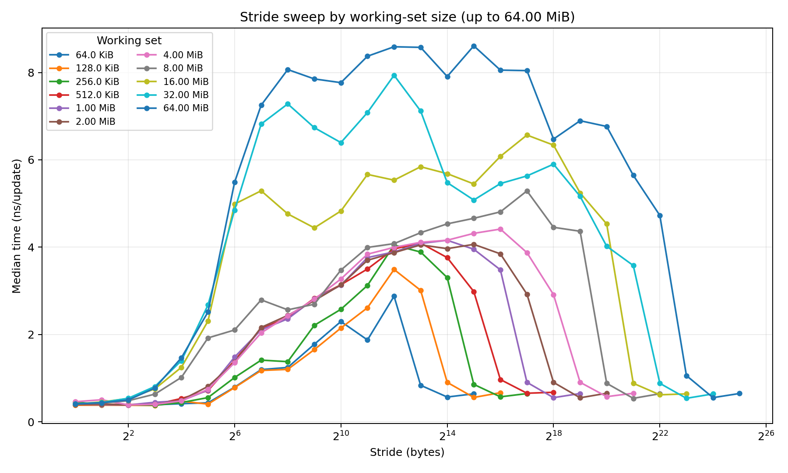
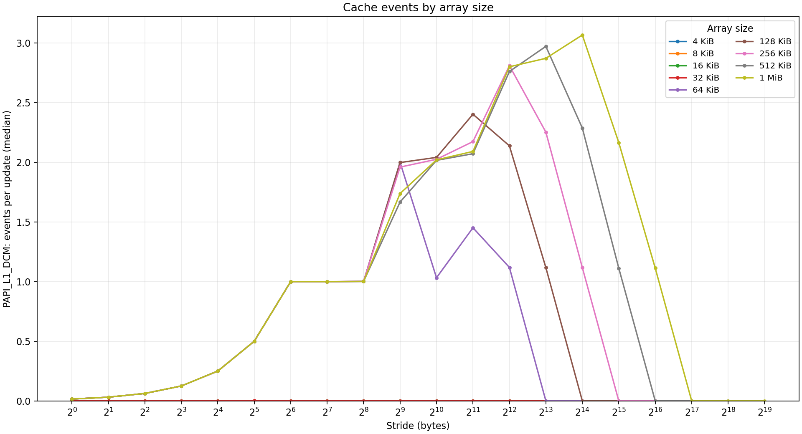
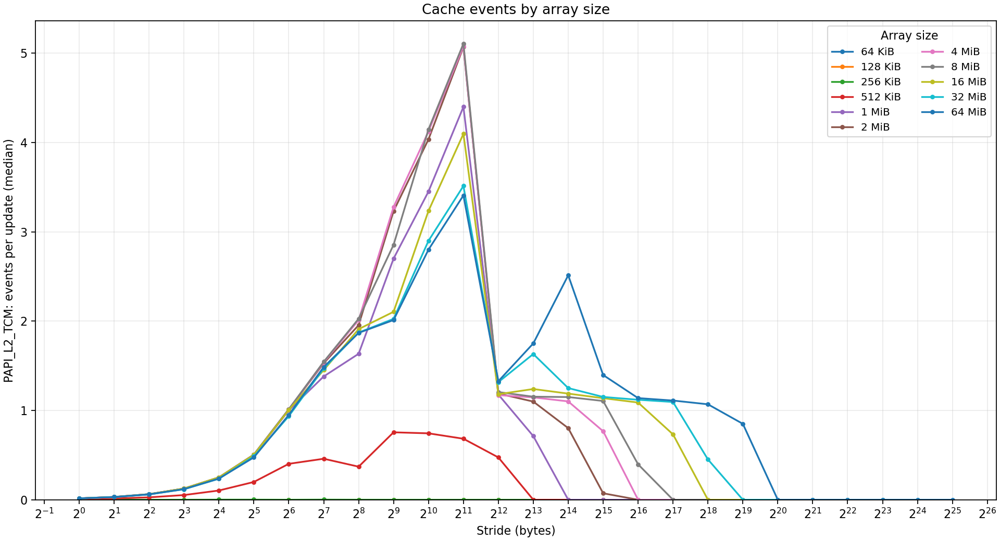

# OC — Laboratório 1: System Profiling and Modeling

## Exercício 1 — Comportamento da cache através de medições de tempo (Secção 2)

### a) Plataforma

| Item | Valor |
|---|---|
| Processador | 11th Gen Intel Core i5-11500 @ 2.70 GHz (Rocket Lake; 6 núcleos / 12 threads) |
| Sistema operativo | Linux 6.12.40, x86_64 (computador do laboratório, execução nativa) |
| Compilador | GCC 14.2.1 20250322 |
| Opções de compilação | `-O2 -std=gnu11 -Wall -Wextra` (valores por omissão do `Makefile`) |

Todas as medições do Exercício 1 foram feitas na mesma máquina, com o mesmo compilador e as mesmas opções.

### b) Array de 16 KiB

| Stride (bytes) | Primeiros quatro offsets acedidos | Elementos atualizados por passagem |
|---:|---|---:|
| 1 | 0, 1, 2, 3 | 16384 / 1 = 16384 |
| 32 | 0, 32, 64, 96 | 16384 / 32 = 512 |
| 64 | 0, 64, 128, 192 | 16384 / 64 = 256 |

### c) Capacidade da cache L1 de dados

**Estimativa: entre 32 KiB e 64 KiB.**

Para strides pequenos (1–8 B), todas as curvas estão em ≈ 0,6 ns/update. Aí, cada linha carregada serve muitas atualizações consecutivas e o *prefetcher* esconde a latência, por isso estes strides não distinguem os tamanhos. A diferença aparece a partir de 64 B, quando cada atualização passa a usar uma linha diferente:

| Stride | 4 KiB | 8 KiB | 16 KiB | 32 KiB | **64 KiB** | 128 KiB | 256 KiB |
|---:|---:|---:|---:|---:|---:|---:|---:|
| 64 B | 0,58 | 0,66 | 0,65 | 0,62 | **1,26** | 1,34 | 1,29 |
| 128 B | 0,55 | 0,75 | 0,67 | 0,69 | **1,97** | 2,02 | 1,94 |
| 512 B | 0,57 | 0,62 | 0,66 | 0,80 | **2,51** | 2,58 | 2,62 |
| 1 KiB | 0,83 | 0,73 | 0,74 | 0,80 | **2,89** | 2,84 | 2,92 |

(ns/update, mediana; valores de `e1/L1/cache_table.md`)

As curvas de 4 a 32 KiB ficam todas abaixo de ≈ 0,8 ns até strides de 1 KiB. A curva de 64 KiB salta para o dobro ou mais (1,26 ns a 64 B; 2,51 ns a 512 B) e coincide com as de 128 KiB e 256 KiB. Logo, um array de 32 KiB cabe na L1 e um de 64 KiB já não cabe: a capacidade está no intervalo ]32, 64] KiB. Isto é coerente com o `lscpu` da máquina (288 KiB para 6 núcleos, ou seja, 48 KiB por núcleo).

Notas:
- O último ponto de cada curva (stride = N/2) sobe para ≈ 1,49 ns em **todos** os tamanhos, incluindo 4 KiB. Não são *misses*: cada passagem faz só 2 atualizações, e o custo fixo do ciclo por passagem domina.
- Nos strides muito grandes, as curvas de 64 KiB a 1 MiB voltam a descer, porque são acedidas poucas linhas (N/s pequeno) e essas cabem de novo na L1.
- Já se nota uma subida entre 512 KiB e 1 MiB (por exemplo, 1,43 → 2,18 ns a 64 B), o que indica o próximo nível de cache. Este efeito é estudado na alínea d).

### d) Capacidade da cache L2

**Intervalo de tamanhos usado: mínimo `WORKING_SET_MIN` = 64 KiB, máximo `WORKING_SET_MAX` = 64 MiB.** O mínimo é 2 × 32 KiB, o limite inferior do intervalo estimado para a L1. Assim, a primeira curva fica imediatamente acima da L1. Os restantes parâmetros não foram alterados.

**Estimativa: ≈ 0,5 MiB (intervalo ]0,25; 1] MiB).**

| Stride | 64 KiB | 128 KiB | 256 KiB | **512 KiB** | 1 MiB | 2 MiB | 4 MiB | 8 MiB | 16 MiB |
|---:|---:|---:|---:|---:|---:|---:|---:|---:|---:|
| 64 B | 1,28 | 1,27 | 1,25 | **1,67** | 1,93 | 1,95 | 1,95 | 2,01 | 17,34 |
| 128 B | 1,92 | 1,91 | 1,91 | **2,25** | 3,49 | 3,54 | 3,55 | 3,59 | 20,12 |
| 512 B | 2,49 | 2,58 | 2,62 | **3,43** | 5,35 | 5,54 | 5,44 | 5,13 | 21,51 |
| 1 KiB | 2,89 | 2,85 | 2,84 | **3,44** | 5,93 | 6,27 | 6,30 | 6,40 | 10,60 |

(ns/update, mediana; valores de `e1/L2/cache_table.md`)

- Entre 64 e 256 KiB as curvas praticamente coincidem: os dados cabem na L2.
- A partir de 1 MiB há um novo patamar, sustentado e claramente mais alto (por exemplo, a 128 B: 1,91 → 3,5 ns; a 512 B: 2,6 → 5,4 ns), que se mantém até 8 MiB.
- 512 KiB fica a meio dos dois patamares. Este array tem exatamente o tamanho da L2 (512 KiB por núcleo, segundo o `lscpu`: 3 MiB / 6) e por isso não cabe todo. A L2 também guarda código, pilha e entradas de tabelas de páginas, a substituição não é LRU perfeita e, como a L2 é indexada por endereço físico, as páginas não se distribuem uniformemente pelos conjuntos.

Vê-se ainda uma terceira transição, muito mais forte, entre 8 MiB e 16 MiB (a 64 B: 2,01 → 17,34 ns). Corresponde ao fim da L3 partilhada (12 MiB) e à passagem para DRAM. As curvas de 16 a 64 MiB têm muito ruído (por exemplo, 16 MiB a 128 B: mínimo 6,15 ns, máximo 27,66 ns). Isso deve-se à memória principal, às falhas de TLB e à partilha da L3 com outros processos.

### e) Tamanho da linha da L1

**Arrays escolhidos (maiores que a L1 e menores que a L2): 128 KiB e 256 KiB**, confirmados com 64 KiB.

| Stride | 1–8 B | 16 B | 32 B | 64 B | 128 B | 256 B | 512 B |
|---|---:|---:|---:|---:|---:|---:|---:|
| 64 KiB | 0,61–0,71 | 0,73 | 0,77 | 1,28 | 1,92 | 1,83 | 2,49 |
| 128 KiB | 0,61–0,63 | 0,70 | 0,78 | 1,27 | 1,91 | 2,06 | 2,58 |
| 256 KiB | 0,61–0,62 | 0,82 | 0,83 | 1,25 | 1,91 | 1,87 | 2,62 |

(ns/update; corrida L2)

**Estimativa: 64 B (intervalo 64–128 B). Só com tempos, este valor não é totalmente fiável.**

Nos três tamanhos, o tempo é plano até 32 B e depois sobe duas vezes seguidas: 32 → 64 B (≈ ×1,6) e 64 → 128 B (≈ ×1,5). Entre 128 e 256 B forma-se um pequeno patamar. O padrão ideal seria uma subida até ao tamanho da linha seguida de um patamar. Aqui há dois degraus, e isso é compatível com linhas de 64 B combinadas com o *prefetcher* de linha adjacente, que traz pares de linhas alinhados a 128 B. Com stride 64 B, metade das linhas chega "de borla"; com 128 B, cada atualização precisa de um novo par. A partir de 512 B o tempo volta a subir por outros motivos: o *prefetcher* deixa de acompanhar e há mais páginas e falhas de TLB. Por isso, os tempos indicam uma linha entre 64 e 128 B, e o Exercício 2 confirma que são 64 B.

---

## Exercício 2 — Comportamento da cache com contadores de hardware (Secção 3)

### a) Plataforma e eventos

Usou-se a mesma máquina do Exercício 1: Intel Core i5-11500, Linux 6.12.40, GCC 14.2.1 e PAPI 7.2.0 compilado localmente. A execução foi nativa (PAPI indica *Running in a VM: no*). Opções de compilação: `-O2 -std=c11 -Wall -Wextra`, com ligação estática a `libpapi.a` e `-ldl -lpthread`.

| Experiência | Evento usado | Evento nativo | Descrição (`event_details.txt`) |
|---|---|---|---|
| L1 | `PAPI_L1_DCM` — *Level 1 data cache misses* | `L1D:REPLACEMENT` | "Counts the number of cache lines replaced in L1 data cache." |
| L2 | `PAPI_L2_TCM` — *Level 2 cache misses* | `LLC_REFERENCES` | "Count each request originating from the core to reference a cache line in the last level cache. The count may include speculation, but excludes cache line fills due to hardware prefetch." |

Para a L2 usou-se `PAPI_L2_TCM`. Neste processador, `PAPI_L2_DCM` é um evento derivado (*Deriv = Yes* em `available_events.txt`). `PAPI_L2_TCM` está mapeado num único evento nativo: cada pedido do núcleo à L3 (*last level cache*) corresponde a uma falha na L2, incluindo leituras e RFOs (escritas), mas não os *prefetches* da L2.

### b) Capacidade da L1 (`PAPI_L1_DCM`)

**Intervalo final: 4 KiB a 1 MiB** (o intervalo por omissão já cobria a transição).

**Estimativa: entre 32 KiB e 64 KiB.**

| Stride | 4 KiB | 8 KiB | 16 KiB | 32 KiB | **64 KiB** | 128 KiB |
|---:|---:|---:|---:|---:|---:|---:|
| 1 B | 7,2e-5 | 2,9e-6 | 1,9e-5 | 1,4e-4 | **0,0157** | 0,0157 |
| 16 B | 8,6e-6 | 1,1e-5 | 3,3e-4 | 1,5e-4 | **0,250** | 0,250 |
| 64 B | 4,9e-5 | 2,9e-6 | 1,0e-5 | 1,5e-4 | **1,000** | 1,000 |
| 256 B | 0 | 5,1e-5 | 1,5e-5 | 6,4e-5 | **0,933** | 1,000 |

(eventos por atualização, mediana)

Até 32 KiB há praticamente zero eventos (≤ 3e-4 por atualização): depois do aquecimento, todos os acessos são *hits*. Com 64 KiB, a taxa passa para exatamente 1 *miss* por linha acedida. 64 KiB excede a L1 (48 KiB) em apenas 33 %, mas mesmo assim todas as linhas falham. Num varrimento cíclico com substituição do tipo LRU, cada linha é expulsa antes de voltar a ser usada.

### c) Capacidade da L2 (`PAPI_L2_TCM`)

**Intervalo final: 64 KiB a 64 MiB.** O mínimo é 2 × 32 KiB; o intervalo é o mesmo da alínea 2d), que já tinha mostrado a transição perto de 512 KiB.

**Estimativa: ≈ 0,5 MiB (intervalo ]0,25; 1] MiB).**

| Stride | 128 KiB | 256 KiB | **512 KiB** | 1 MiB | 2 MiB | 64 MiB |
|---:|---:|---:|---:|---:|---:|---:|
| 1 B | 3,4e-5 | 7,6e-4 | **0,0074** | 0,0155 | 0,0157 | 0,0152 |
| 16 B | 2,9e-5 | 1,2e-3 | **0,103** | 0,248 | 0,250 | 0,237 |
| 64 B | 1,9e-6 | 1,5e-4 | **0,402** | 1,000 | 1,012 | 0,950 |
| 128 B | 2,6e-5 | 1,4e-3 | **0,459** | 1,381 | 1,529 | 1,487 |

(eventos por atualização, mediana)

- Até 256 KiB não há falhas na L2 (≤ 1,4e-3).
- Com 512 KiB, cerca de 40–46 % das linhas falham: o array tem o tamanho exato da L2 e não cabe todo, pelas razões indicadas em 1d).
- A partir de 1 MiB, todas as linhas falham (1 evento por linha a 64 B).

O intervalo cobre os dois lados da transição. Como era de esperar, não aparece nenhuma transição da L3: o evento mede falhas na L2, e a L3 só mudaria o custo dessas falhas, não o seu número.

### d) Tamanho da linha da L1

**Array escolhido: 128 KiB** (maior que a L1, de 48 KiB, e menor que a L2, de 512 KiB). Os resultados confirmam-se com 256 KiB e 64 KiB.

| Stride s | 1 | 2 | 4 | 8 | 16 | 32 | **64** | 128 | 256 |
|---|---:|---:|---:|---:|---:|---:|---:|---:|---:|
| 128 KiB | 0,01567 | 0,0313 | 0,0626 | 0,125 | 0,250 | 0,500 | **1,000** | 1,000 | 1,000 |
| 256 KiB | 0,01566 | 0,0313 | 0,0626 | 0,125 | 0,250 | 0,500 | **1,000** | 1,000 | 1,000 |
| s/64 | 0,01563 | 0,0313 | 0,0625 | 0,125 | 0,250 | 0,500 | 1 | — | — |

**Estimativa: 64 B.** Os eventos por atualização duplicam a cada duplicação do stride e seguem exatamente s/64, com 1/64 = 0,0156 no stride 1. A partir de 64 B ficam num patamar de 1,0. É precisamente o comportamento de linhas de 64 B: com s < 64 há 64/s atualizações por linha e um *miss* por linha; com s ≥ 64, cada atualização usa uma linha nova. A mudança acontece no mesmo stride em todos os arrays acima da L1 (64 KiB, 128 KiB, 256 KiB, 512 KiB e 1 MiB).

### e) Justificação e comparação com o Exercício 1

**Capacidade da L1.** Compara-se 32 KiB com 64 KiB a stride 64 B: 1,5e-4 contra 1,00 eventos por atualização (PAPI) e 0,62 contra 1,26 ns por atualização (tempo). Os dois métodos dão ]32, 64] KiB.

**Capacidade da L2.** Compara-se 256 KiB, 512 KiB e 1 MiB a stride 64 B: 1,5e-4, 0,40 e 1,00 eventos por atualização, contra 1,25, 1,67 e 1,93 ns por atualização. Os dois métodos põem a transição em 512 KiB, com o valor de 512 KiB intermédio, e estimam ≈ 0,5 MiB.

**Tamanho da linha.** Com contadores, o resultado é inequívoco (64 B, ajuste exato a s/64). Com tempos, ficava ambíguo entre 64 e 128 B.

**Os contadores tornaram as transições mais claras?** Sim. Nos tempos, as transições são aumentos de cerca de 1,5 a 2 vezes, porque a execução fora de ordem e os *prefetchers* escondem parte da latência e o tempo medido inclui o custo do ciclo. Nos contadores, a contagem de *misses* passa de ≈ 0 para 1 por linha (vários ordens de grandeza), e os valores mínimo e máximo das 5 amostras ficam muito próximos da mediana. O *miss* é contado mesmo quando a sua latência fica sobreposta a outro trabalho.

**Limitações e aspetos inconclusivos:**

- **Valores acima de 1 evento por atualização.** Na L1 chegam a 2,8 com strides ≥ 512 B, e na L2 chegam a 5 com strides de 128 B a 2 KiB. Isto mostra que não são probabilidades de *miss*.
  - `L1D:REPLACEMENT` conta todas as linhas substituídas na L1, incluindo as trazidas pelos *prefetchers* da L1 (por exemplo, a linha seguinte, que nunca é usada) e as entradas de tabelas de páginas lidas nos *page walks*. Com strides ≥ 4 KiB, cada atualização toca uma página diferente: um array de 1 MiB tem 256 páginas, mais do que a DTLB consegue cobrir.
  - `LLC_REFERENCES` conta todos os pedidos do núcleo à L3, incluindo pedidos especulativos e pedidos dos *prefetchers* da L1, e exclui só os *prefetches* da L2. A descida para ≈ 1,2 a partir de strides de 4 KiB é compatível com o facto de os *prefetchers* não atravessarem fronteiras de página de 4 KiB.
  - Por isso, as capacidades e a linha foram estimadas na zona de strides pequenos e moderados (≤ 256 B), onde a contagem segue o modelo de um *miss* por linha.
- **Descidas nos strides muito grandes.** Nestes strides acede-se a muito poucas linhas. Mostram também a associatividade da L1. Com strides múltiplos de 4 KiB (= 64 conjuntos × 64 B), todas as linhas caem no mesmo conjunto:
  - com 16 linhas (64 KiB/4 KiB, 128 KiB/8 KiB, 256 KiB/16 KiB, 512 KiB/32 KiB e 1 MiB/64 KiB) há 0,60–0,68 eventos por atualização;
  - com 8 linhas (64 KiB/8 KiB, 128 KiB/16 KiB, …) há ≈ 0.

  A associatividade está portanto entre 8 e 16 vias, o que é coerente com uma L1 de 48 KiB e 12 vias. O mesmo efeito vê-se nos tempos (64 KiB: 3,14 ns a stride 4 KiB contra 1,21 ns a stride 8 KiB). Com 16 linhas num conjunto de 12 vias, uma substituição LRU pura daria 1 *miss* por acesso. O valor medido de ≈ 0,65 indica uma política pseudo-LRU ou adaptativa.
- **Valor intermédio em 512 KiB.** A L2 é indexada fisicamente e partilhada com código, pilha e tabelas de páginas, por isso não é possível dizer exatamente em que tamanho a transição ocorre. Daí a estimativa por intervalo.
- **Ruído do sistema.** O computador do laboratório é partilhado. Nas medições de tempo de arrays ≥ 16 MiB há uma grande variação entre amostras. Os contadores são muito menos sensíveis a isto, porque contam apenas eventos em modo utilizador da região medida.

### Arquivos de entrega

- `entregas/ex1_L1_L2.zip`: `L1/` e `L2/`, cada um com `results.csv`, `cache_table.md` e `cache_time.png`.
- `entregas/ex2_L1_L2.zip`: `L1/` e `L2/`, cada um com `results.csv`, `cache_table.md`, `cache_misses.png` e `event_details.txt`.
